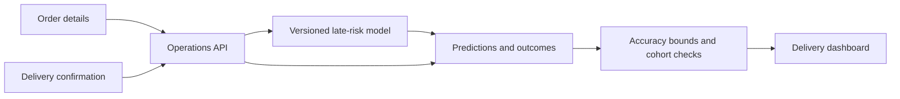

# Delayed Label Monitor

**MLOps monitoring for delivery predictions with delayed outcomes.** Score an order today, verify the prediction when delivery is confirmed, and see how much of the model's measured accuracy is still uncertain.

[**Open hosted dashboard**](https://delayed-label-monitor-demo.bubblybobcat3.chatgpt.site/) · [Historical delivery study](https://delayed-label-monitor-demo.bubblybobcat3.chatgpt.site/delivery-study.html) · [Drift and retraining experiments](https://delayed-label-monitor-demo.bubblybobcat3.chatgpt.site/research-study.html)

The hosted dashboard uses operator-entered outcomes and currently requires access. The local workflow below provides the same prediction and verification demo.

## System design



FastAPI uses SQLite locally. The hosted Cloudflare Worker uses D1 and the same trained model artifact. Each order keeps the prediction and model version produced when it was scored. A later outcome resolves the order and updates the reliability view.

## What the experiments show

| Evaluation | Result |
| --- | --- |
| 60-order API replay | In the simulated São Paulo cohort, early-report accuracy was **15.6%**. Once all outcomes arrived, it was **33.3%**, inside the early **10.4%–43.8%** range. |
| Historical reporting audit | **32,150 Olist orders** were used to study how label availability changes across regions and cohorts. |
| Drift and retraining simulation | For the tested 30-day delay scenario at eight minority predictions per day, harm was detected in **100/100 runs**. The 120-day horizon produced zero promotions. The 160-day horizon allowed 100/100 promotions in that setting. |

The accuracy range covers possible final accuracy for the saved orders. The operational dashboard collects evidence while outcomes arrive. Candidate evaluation remains a separate research and staging workflow.

## Run the demo

```sh
python -m pip install -r requirements.txt -r requirements-research.txt
python -m uvicorn serving:app --port 8000
```

Open [localhost:8000](http://localhost:8000), add a fictitious order, and record its delivery to see it move from **Awaiting outcome** to **Verified**. For a complete delayed-outcome replay and automated checks:

```sh
python delivery_workflow_demo.py
python -m unittest discover -v
node hosted/test-worker.mjs
```

## Repository map

| Path | Purpose |
| --- | --- |
| `serving.py`, `web/` | FastAPI entry point and operations dashboard |
| `hosted/` | Worker runtime, D1 schema, and parity tests |
| `research/`, `delivery-results/` | Experiment modules, protocols, and historical results |
| `tests/` | Python regression and integration tests |
| `docs/` | Hosting and portfolio demo instructions |

Run research modules from the repository root, for example `python -m research.real_world_validation --help`.

[Demo recording and hosting guide](docs/DEMO_AND_HOSTING.md) · [Research progress](research/PROGRESS.md)
